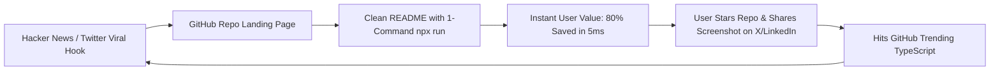

# 📈 ContextPrune: The 10k-Star Viral Marketing Playbook

This document details the exact **Go-To-Market (GTM) strategy, distribution channels, influencer outreach templates, and viral loops** to scale **ContextPrune** to thousands of GitHub stars and active developer adoption.

---

## 🎯 1. Core Positioning & The "Aha!" Moment

- **The Hook:** *"Stop feeding your AI the whole repo. Prune it."*
- **The Value:** Cuts 50%–85% of tokens, saves \$0.50–\$1.50 per query, eliminates LLM hallucinations, and works via `npx` in 15 milliseconds.
- **The Category:** AI Developer Tooling / Context Optimization / Model Context Protocol (MCP).

---

## 🗓️ 2. The 7-Day Launch Schedule

```
Day -1: Visual Assets & GitHub Polish (Demo GIF + Social Preview)
Day 0: Hacker News (Show HN) at 8:00 AM EST + Twitter/X Thread
Day 1: Subreddit Campaign (r/LocalLLaMA, r/ClaudeAI, r/Cursor)
Day 2: Developer Newsletters (TLDR, Console.dev, Bytes.dev)
Day 3: GitHub Trending Push (Top 10 JS/TS repos of the day)
Day 4: YouTube & Tech Influencer outreach
Day 5+: Community feature requests & ecosystem integrations (MCP plugins)
```

---

## 🚀 3. Phase-by-Phase Execution

### Phase 1: Pre-Launch Asset Setup
1. **GitHub OpenGraph Banner (Social Preview):**
   - Create a clean 1280x640 dark-mode banner showing the terminal report:
     `"104k tokens -> 18k tokens (82% Saved)"`
   - Tools: Canva or Figma.
2. **Terminal GIF Demo:**
   - Record an ultra-crisp 8-second animated GIF showing:
     `npx contextprune --task "fix auth" --model claude`
     -> Green optimization table appears instantly -> "Copied to clipboard!"
   - Tool: `vhs` (https://github.com/charmbracelet/vhs) or ScreenToGif.
3. **GitHub Topics to Tag:**
   `llm`, `claude`, `cursor`, `mcp`, `ollama`, `developer-tools`, `prompt-engineering`, `ast`, `token-optimizer`, `typescript`, `python`.

---

### Phase 2: Hacker News "Show HN" (The #1 Traffic Driver)

- **Best Time:** Tuesday or Wednesday between **7:45 AM - 8:30 AM EST** (peak Silicon Valley waking hours).
- **Title:**
  > Show HN: ContextPrune – Stop feeding whole repos to LLMs. AST pruning saves 80% tokens
- **First Comment by Author (Authentic Story):**
  > *"Hey HN! I've been heavily using Claude 3.5 Sonnet and Cursor for daily coding. Whenever I needed to prompt about a bug, tools like Repomix dumped the entire 80-file codebase into the prompt. That burned 100k+ tokens every single time ($0.50-$1.50 a pop) and caused severe attention degradation ('lost in the middle').*
  >
  > *I realized that to fix a Stripe webhook, the LLM doesn't need 500 lines of DB connection pool logic. It only needs the type signatures, interfaces, and function contracts.*
  >
  > *So I built ContextPrune: a zero-dependency CLI that parses ASTs (TS, Python, Go, Rust), strips inner implementation bodies of secondary files, and keeps only what the AI needs.*
  >
  > *It also supports a native MCP server (`npx contextprune mcp`) for Claude Desktop and Cursor.*
  >
  > *Try it: `npx contextprune --task "your task"`*
  > *GitHub: https://github.com/maniraja5599/contextprune*
  >
  > *Would love your feedback on the skeletonizer heuristics!"*

---

### Phase 3: X (Twitter) Viral Thread Formula

**Tweet 1 (The Hook Video):**
> Stop feeding your AI the whole repository. 🛑
>
> Dumping 60 full files into Claude or Cursor burns 100k+ tokens and causes massive hallucinations.
>
> Your LLM only needs the type signatures, not internal connection pool logic.
>
> Introducing ContextPrune ✂️:
> 85% token reduction via AST skeletonization in <15ms.
>
> 🧵👇 [Attach GIF/Video]

**Tweet 2 (Technical Proof):**
> ❌ Repomix: Dumps 200 lines of `database.ts` (1,200 tokens)
> ✅ ContextPrune: Keeps method signatures and return types, strips the rest (85 tokens)
>
> Preserves 100% type safety and contracts.
> Saves $0.25+ on every single query.

**Tweet 3 (Local LLM & Ollama Angle):**
> If you use local LLMs (Ollama / Llama 3) with an 8k context window, this is an absolute lifesaver:
>
> `npx contextprune --model ollama --task "fix bug"`
>
> Strictly trims code to fit into your local context budget automatically.

**Tweet 4 (CTA):**
> - 0 npm dependencies
> - Built-in MCP server for Claude & Cursor (`npx contextprune mcp`)
> - Supports TypeScript, Python, Go, Rust
>
> Star it on GitHub:
> 🔗 https://github.com/maniraja5599/contextprune

---

### Phase 4: Subreddit Blitz (High Intent Communities)

1. **r/LocalLLaMA:**
   - **Angle:** *"I built an open-source AST context optimizer to fit full codebases into small 8k/16k context windows without losing architecture."*
   - (LocalLLaMA users are obsessed with token budget and small context limits — this will perform exceptionally well here).
2. **r/ClaudeAI:**
   - **Angle:** *"Stop burning $10/day on Claude codebase prompts: ContextPrune open-source release."*
3. **r/Cursor:**
   - **Angle:** *"How to connect ContextPrune as an MCP server in Cursor to reduce context pollution."*
4. **r/programming:**
   - **Angle:** *"AST Skeletonization: Cutting 80% of prompt tokens while preserving type contracts."*

---

### Phase 5: Developer Newsletter Submissions

Submit a 2-line pitch to these free developer aggregators:
- **TLDR Web Dev & TLDR AI:** (https://tldr.tech/)
- **Console.dev:** (Weekly newsletter focusing on great open-source developer tools)
- **Daily.dev:** (Submit as a tool resource)
- **Bytes.dev:** (By ui.dev — JavaScript news)
- **Node Weekly / JavaScript Weekly:** (By Cooperpress)

---

### Phase 6: YouTube Creator Outreach (The Scaling Engine)

Reach out to tech YouTubers who cover AI dev tools:
- **Matthew Berman** (Covers local LLM workflows, MCP tools)
- **Fireship** ("The Code Report" / quick tool shouts)
- **IndyDevDan** (Deep dives into Claude & MCP workflows)
- **Theo - t3.gg** (Reviews developer tool ergonomics)

**Pitch Email Template:**
```text
Subject: Open Source Tool: ContextPrune (AST token optimizer for Claude & Cursor)

Hey [Name],

Love your videos on [recent video topic].

Quick heads up about an open source tool we just launched: ContextPrune (https://github.com/maniraja5599/contextprune).

It solves the massive "context bloat" problem when feeding repos to Claude/Cursor. Instead of raw dumping whole files (like Repomix), it uses AST skeletonization to keep interfaces & method signatures while stripping inner logic, cutting prompt tokens by 80%+ and running natively as an MCP server.

Zero dependencies, instant npx run.

Thought your audience might find it useful!
Cheers,
[Your Name]
```

---

## 🏆 4. The GitHub Star Growth Loop



By following this playbook step-by-step, **ContextPrune** has all the ingredients (pain point, visual proof, zero-friction install, MCP integration) to become a staple developer tool in the AI engineering ecosystem.
